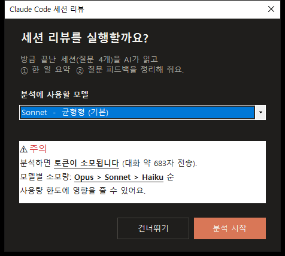
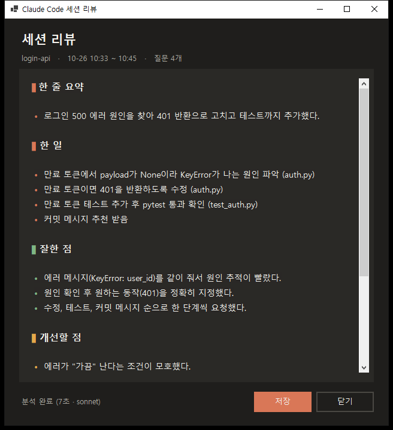

# session-review

Claude Code 세션이 끝나면 대화를 분석해 **한 일 요약**과 **질문 피드백**을 보여주는 `SessionEnd` 훅 (Windows / PowerShell).

## 훅 이름

`session-review` (세션 리뷰)

- 훅 이벤트: `SessionEnd`
- 파일: `session-review.ps1`

## 훅 설명

세션을 종료하면 확인 창이 뜨고, **분석 시작**을 누르면 방금 끝난 대화를 `claude -p`로 분석해 결과 창에 보여줍니다.

| 섹션 | 내용 |
| --- | --- |
| 한 줄 요약 | 이 세션에서 무엇을 했는지 |
| 한 일 | 핵심 작업 2~4개 (바뀐 파일명 포함) |
| 잘한 점 | 질문·요청 방식에서 좋았던 점 |
| 개선할 점 | 아쉬웠던 점 + 더 좋은 질문 예시 |
| 다음엔 이렇게 | 다음 세션에 바로 쓸 팁 |

- 분석 전에 **실행 여부와 모델(Sonnet / Opus / Haiku)을 직접 고릅니다.** 분석은 토큰을 소모하므로 자동으로 실행되지 않습니다.
- 질문 없이 끝난 세션에서는 창이 뜨지 않습니다.
- 훅은 창 프로세스를 분리해 실행하므로 Claude Code 종료를 막지 않습니다.
- 결과는 `저장` 버튼으로 `.txt`에 저장할 수 있습니다.
- 분석용 `claude` 세션은 `disableAllHooks`로 실행되어 이 훅이 다시 실행되지 않습니다.

**요구 사항**: Windows 10 이상, [PowerShell 7](https://learn.microsoft.com/powershell/scripting/install/installing-powershell-on-windows) (`pwsh`), PATH에 잡힌 `claude` CLI

**개인정보 주의**: 분석할 때 대화 기록(최대 약 60,000자)이 Claude에 전송됩니다.

## 훅 설치 명령어

### 방법 1. 한 줄 설치 (PowerShell)

```powershell
irm https://raw.githubusercontent.com/Leeyuno0419/session-review-hook/main/install.ps1 | iex
```

`~/.claude/hooks/session-review.ps1`을 내려받고 `~/.claude/settings.json`의 `SessionEnd`에 등록합니다. 기존 설정은 유지되고, 변경 전 `settings.json.bak`으로 백업됩니다. 이미 등록돼 있으면 스크립트만 갱신합니다.

### 방법 2. git clone + 수동 등록

```powershell
git clone https://github.com/Leeyuno0419/session-review-hook.git
New-Item -ItemType Directory -Force "$HOME\.claude\hooks" | Out-Null
Copy-Item session-review-hook\session-review.ps1 "$HOME\.claude\hooks\"
```

그다음 `~/.claude/settings.json`에 아래를 추가합니다. 이미 `hooks.SessionEnd`가 있으면 배열에 항목만 덧붙입니다. 경로의 `사용자명`은 본인 계정으로 바꾸세요.

```json
{
  "hooks": {
    "SessionEnd": [
      {
        "hooks": [
          {
            "type": "command",
            "command": "pwsh -NoProfile -File \"C:/Users/사용자명/.claude/hooks/session-review.ps1\"",
            "timeout": 15
          }
        ]
      }
    ]
  }
}
```

설치 후 Claude Code를 다시 시작하세요.

## 훅 사용 예시

1. 평소처럼 Claude Code를 사용하다가 `/exit`로 세션을 끝냅니다.
2. 확인 창이 뜨면 모델을 고르고 **분석 시작**을 누릅니다. (원치 않으면 **건너뛰기**)
3. 7초~1분 뒤 결과 창이 표시됩니다.

**1. 세션 종료 시 뜨는 확인 창**



**2. 분석 결과 창** (스크롤하면 "개선할 점"의 질문 예시와 "다음엔 이렇게"가 이어집니다)



> 위 화면은 샘플 세션(로그인 API 500 에러 수정)으로 훅을 실제 실행해 캡처한 것입니다.

## 설정

`session-review.ps1` 맨 위의 값을 바꾸면 됩니다.

| 변수 | 기본값 | 설명 |
| --- | --- | --- |
| `$Model` | `sonnet` | 확인 창의 기본 선택 모델 (`sonnet` / `opus` / `haiku`) |
| `$MaxLogChars` | `60000` | 분석에 보낼 대화 최대 길이 (넘치면 앞 1/4 + 뒤 3/4만 사용) |
| `$TimeoutSec` | `300` | 분석 최대 대기 시간(초) |
| 색상 변수 | — | 창 배경·강조색 등 |

## 제거

`~/.claude/settings.json`의 `hooks.SessionEnd`에서 해당 항목을 지우고 `~/.claude/hooks/session-review.ps1`을 삭제하세요.
